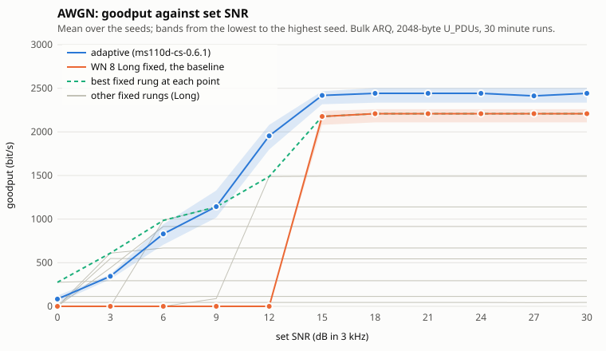
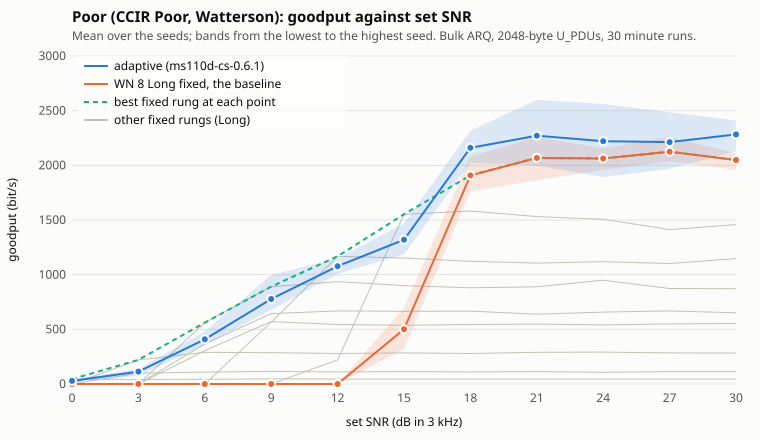
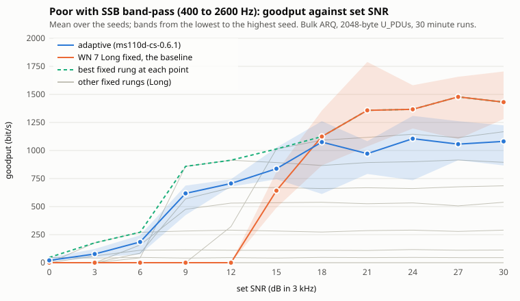

# Rate selection: throughput against SNR (P7-10)

This page publishes what the node's adaptive rate selection (phase 7) delivers over simulated HF channels, against the best single fixed waveform an operator could pick without knowing the channel. It is the evidence for the phase 7 done-when of plan 12.

**In short.** The adaptive node beats the baseline wherever the baseline works at all, and it keeps delivering data at low SNR where the baseline delivers nothing. On AWGN it gains about 10% over the baseline from 15 dB up and delivers from 0 dB. On Poor it gains 4 to 13% from 18 dB up (and over 160% at 15 dB, where the baseline is on the edge of failing) and delivers from 0 dB. On Poor with the SSB band-pass it delivers from 0 dB too, but above 15 dB it sits 4 to 28% below the baseline (a fixed WN 7 chosen with hindsight), because it does not climb to the best rung there. Below about 12 dB it is 8 to 70% below the best fixed rung at each point (more on SSB), which is the price of not knowing the channel. Links were lost at the lowest SNRs: 20 across the 165 adaptive runs (AWGN 0 dB, Poor 0 dB, and Poor-SSB at 0, 3 and 6 dB). **30 of 33 points pass the phase 7 gate**; the three that fail are the Poor-SSB points at 0, 3 and 6 dB, on links lost only (issue #109).

## Method

**What runs.** Two whole nodes (core, host input order, an in-process M0LTE.Ms110d modem each) joined by one continuous Watterson channel per direction (M0LTE.HfChannel), on a virtual clock. Node a sends 2048-byte ARQ U_PDUs to node b as fast as flow control allows; node b sends a 100-byte ARQ message to a every 60 s. Each run is 30 minutes of channel; goodput is the bulk bytes delivered after the first 60 s, in bit/s. Details: docs/stack-sweep.md.

**Channels and SNR.** AWGN, Poor (ITU-R F.1487 Poor, Watterson), and Poor with the SSB band-pass of both radios (400 to 2600 Hz). The set SNR is the signal power at the channel input, after the transmit passband where there is one, over the noise in 3000 Hz at the receiver's antenna (the P7-5 reference). 0 to 30 dB in 3 dB steps; seeds 1 to 5 per point; every channel realisation, payload and contention draw follows from the seed.

**The two arms.**

- Adaptive: both nodes load the calibrated `drc.table` the host ships (below). The receiver recommends a bulk rung (MAX-SPEED) and a latency rung (LOW-SPEED) from its smoothed SNR estimate, clean-burst runs and error caps; the sender uses them, with a trial and a failed-trial ceiling when it climbs (core-architecture.md section 9, design shape items 1 to 7, interp C-1270, C-1281, C-1291).
- Fixed: an empty `drc.table` and `drc.default_speed` set to one rung, WN 1 to 8 or 13 at the Long interleaver, for the whole run (open question 13). Nine rungs.

Both arms run the same node settings (`tools/s5066-sweep/sweep-node.json`: 8 contention slots of 3 s, listen-before-talk 2 s after DCD and 3 s after VDCD, transmissions of at most 30 s, so a 57 s answer wait) and the same first-data wait, `cas.first_data_timeout_ms` 456000 ms, the value the calibrated table derives (8 answer waits; interp B-0420), set on both so neither arm is favoured.

**The baseline (open question 14).** Per channel, the fixed rung with the highest goodput summed over the sweep. Each point's best fixed rung (an oracle that knows the channel) is shown beside it with the gap, not gated.

**The gate (plan 12, phase 7 done-when).** On AWGN and Poor, at every SNR where any configuration delivers data: adaptive's mean over the seeds strictly above the baseline's mean, or, where the baseline rung is at its measured stack ceiling (its mean within 2% of its highest on the channel), within 2% of that ceiling. On Poor with the SSB band-pass: no link lost, and under 5% of the transmissions after each node's first failed-trial ceiling on rungs that never decode on that channel (rulings (d) and (f) of 2026-11-09). The merge writes the verdict per point (`gate.tsv`).

## Versions

| What | Version |
|---|---|
| M0LTE.S5066 commit | 2ee88f4a71b6dc97d38ec953f14284f820bd411e (`s5066_core` 0.1.2) |
| Corpus (s5066-conformance) | 0.38.0 |
| Calibrated table | s5066-conformance `calibration/ms110d-cs-0.6.1/drc-table.json`, built by `tools/build_drc_table.py` (bulk objective rate x (1 - e)^2, latency target 100 per mille for a 128-byte message); FNV-1a 64 `d2521f8f279cc235` (`plan.json`; the fixed arms use the empty table, `b934c86f612b17dc`) |
| Modem | M0LTE.Ms110d 0.6.1 (commit ae8ab35; the table was calibrated on 0.6.1, commit be49721) |
| Channel model | M0LTE.HfChannel 0.2.0 (commit 6b9323b), SSB passband 400 to 2600 Hz |
| Sweep | `s5066-sweep --profile final`, 1650 of 1650 runs merged (none missing or failed), 2026-11-10, on a spot box via the spot-broker |

## Results

One plot per channel: adaptive's mean over the seeds with the range from its lowest to its highest seed, the baseline rung the same way, the best fixed rung at each point (dashed) and the other fixed rungs (grey). Made by `tools/s5066-sweep/plot_curves.py` from the merged aggregates.

### AWGN

Baseline: fixed WN 8 Long (highest summed goodput on this channel). It delivers nothing below 15 dB. Adaptive delivers 83 bit/s at 0 dB, 830 bit/s at 6 dB and 2442 bit/s from 18 dB, about 10% above WN 8, which tops out at 2209 bit/s. Between 0 and 12 dB it is 16 to 70% below the best fixed rung at each point (an oracle that knows the channel); at 9 dB it matches it. At 0 dB two links were lost over the five seeds.

| Set SNR (dB) | Adaptive mean (min to max) | Baseline mean (min to max) | Best fixed rung | Gain over baseline | Gap to best fixed | Links lost | Gate |
|---|---|---|---|---|---|---|---|
| 0 | 82.9 (37.7 to 122.4) | 0.0 (0.0 to 0.0) | wn3: 274.9 | n/a (baseline 0) | -69.9% | 2 | pass |
| 3 | 344.6 (310.7 to 367.2) | 0.0 (0.0 to 0.0) | wn5: 610.2 | n/a (baseline 0) | -43.5% | 0 | pass |
| 6 | 830.5 (706.2 to 941.6) | 0.0 (0.0 to 0.0) | wn6: 984.9 | n/a (baseline 0) | -15.7% | 0 | pass |
| 9 | 1143.1 (1016.9 to 1327.7) | 0.0 (0.0 to 0.0) | wn6: 1139.3 | n/a (baseline 0) | 0.3% | 0 | pass |
| 12 | 1954.8 (1798.5 to 2081.0) | 0.0 (0.0 to 0.0) | wn7: 1487.7 | n/a (baseline 0) | 31.4% | 0 | pass |
| 15 | 2418.1 (2316.4 to 2467.0) | 2177.0 (2081.0 to 2241.0) | wn8: 2177.0 | 11.1% | 11.1% | 0 | pass |
| 18 | 2442.5 (2335.2 to 2504.7) | 2209.0 (2109.2 to 2259.9) | wn8: 2209.0 | 10.6% | 10.6% | 0 | pass |
| 21 | 2442.5 (2335.2 to 2504.7) | 2209.0 (2109.2 to 2259.9) | wn8: 2209.0 | 10.6% | 10.6% | 0 | pass |
| 24 | 2442.5 (2335.2 to 2504.7) | 2209.0 (2109.2 to 2259.9) | wn8: 2209.0 | 10.6% | 10.6% | 0 | pass |
| 27 | 2412.4 (2335.2 to 2504.7) | 2209.0 (2109.2 to 2259.9) | wn8: 2209.0 | 9.2% | 9.2% | 0 | pass |
| 30 | 2442.5 (2335.2 to 2504.7) | 2209.0 (2109.2 to 2259.9) | wn8: 2209.0 | 10.6% | 10.6% | 0 | pass |

### Poor

Baseline: fixed WN 8 Long, which delivers nothing below 15 dB and only 501 bit/s at 15 dB. Adaptive delivers from 0 dB (28 bit/s, rising to 409 at 6 dB and 1077 at 12 dB) and reaches 2160 to 2283 bit/s from 18 dB, 4 to 13% above the baseline. At 15 dB the baseline is on the edge of failing, so the gain there (about 160%) says little. Adaptive is below the best fixed rung at every point up to 15 dB, by 8 to 49%. Six links were lost at 0 dB, none above.

| Set SNR (dB) | Adaptive mean (min to max) | Baseline mean (min to max) | Best fixed rung | Gain over baseline | Gap to best fixed | Links lost | Gate |
|---|---|---|---|---|---|---|---|
| 0 | 28.2 (18.8 to 37.7) | 0.0 (0.0 to 0.0) | wn1: 45.2 | n/a (baseline 0) | -37.5% | 6 | pass |
| 3 | 113.0 (75.3 to 141.2) | 0.0 (0.0 to 0.0) | wn3: 220.3 | n/a (baseline 0) | -48.7% | 0 | pass |
| 6 | 408.7 (357.8 to 480.2) | 0.0 (0.0 to 0.0) | wn13: 561.2 | n/a (baseline 0) | -27.2% | 0 | pass |
| 9 | 777.8 (678.0 to 998.1) | 0.0 (0.0 to 0.0) | wn13: 890.8 | n/a (baseline 0) | -12.7% | 0 | pass |
| 12 | 1077.2 (1007.5 to 1148.8) | 0.0 (0.0 to 0.0) | wn6: 1167.6 | n/a (baseline 0) | -7.7% | 0 | pass |
| 15 | 1320.1 (1186.4 to 1468.9) | 500.9 (320.1 to 696.8) | wn7: 1551.8 | 163.5% | -14.9% | 0 | pass |
| 18 | 2160.1 (2024.5 to 2316.4) | 1907.7 (1760.8 to 2081.0) | wn8: 1907.7 | 13.2% | 13.2% | 0 | pass |
| 21 | 2271.2 (1996.2 to 2598.8) | 2067.8 (1864.4 to 2259.9) | wn8: 2067.8 | 9.8% | 9.8% | 0 | pass |
| 24 | 2220.3 (1892.6 to 2561.2) | 2062.1 (1958.5 to 2156.3) | wn8: 2062.1 | 7.7% | 7.7% | 0 | pass |
| 27 | 2212.8 (1968.0 to 2485.8) | 2124.3 (2033.9 to 2259.9) | wn8: 2124.3 | 4.2% | 4.2% | 0 | pass |
| 30 | 2282.5 (2128.0 to 2410.5) | 2048.9 (1958.5 to 2109.2) | wn8: 2048.9 | 11.4% | 11.4% | 0 | pass |

### Poor with SSB band-pass

Baseline: fixed WN 7 Long. WN 8 never decodes on this channel (it delivers nothing at any SNR), and the node's ceiling logic learns that. Adaptive delivers from 0 dB (21 bit/s) and reaches about 1000 to 1100 bit/s from 18 dB. That is above the baseline up to 15 dB, but 4 to 28% below it from 18 dB, and 17 to 56% below the best fixed rung everywhere. The SSB gate does not test goodput; it tests links lost and wasted transmissions, below.

| Set SNR (dB) | Adaptive mean (min to max) | Baseline mean (min to max) | Best fixed rung | Gain over baseline | Gap to best fixed | Links lost | Gate |
|---|---|---|---|---|---|---|---|
| 0 | 20.7 (9.4 to 47.1) | 0.0 (0.0 to 0.0) | wn1: 47.1 | n/a (baseline 0) | -56.0% | 8 | fail |
| 3 | 77.2 (47.1 to 122.4) | 0.0 (0.0 to 0.0) | wn3: 177.0 | n/a (baseline 0) | -56.4% | 2 | fail |
| 6 | 184.6 (75.3 to 244.8) | 0.0 (0.0 to 0.0) | wn3: 271.2 | n/a (baseline 0) | -31.9% | 2 | fail |
| 9 | 617.7 (423.7 to 687.4) | 0.0 (0.0 to 0.0) | wn13: 858.7 | n/a (baseline 0) | -28.1% | 0 | pass |
| 12 | 706.2 (678.0 to 743.9) | 0.0 (0.0 to 0.0) | wn13: 913.4 | n/a (baseline 0) | -22.7% | 0 | pass |
| 15 | 838.0 (743.9 to 1026.3) | 642.2 (489.6 to 809.8) | wn6: 1013.2 | 30.5% | -17.3% | 0 | pass |
| 18 | 1075.3 (612.0 to 1261.8) | 1124.3 (866.3 to 1355.9) | wn7: 1124.3 | -4.4% | -4.4% | 0 | pass |
| 21 | 971.7 (791.0 to 1082.8) | 1357.8 (1035.8 to 1789.1) | wn7: 1357.8 | -28.4% | -28.4% | 0 | pass |
| 24 | 1105.5 (734.5 to 1308.8) | 1367.2 (1195.8 to 1581.9) | wn7: 1367.2 | -19.1% | -19.1% | 0 | pass |
| 27 | 1056.5 (913.4 to 1261.8) | 1478.3 (1101.7 to 1657.2) | wn7: 1478.3 | -28.5% | -28.5% | 0 | pass |
| 30 | 1081.0 (866.3 to 1224.1) | 1431.2 (1280.6 to 1704.3) | wn7: 1431.2 | -24.5% | -24.5% | 0 | pass |

The SSB gate inputs per point (a point passes with no link lost and under 5% of transmissions after the first ceiling on rungs that never decode):

| Set SNR (dB) | Links lost | Transmissions after the first ceiling | On never-decoding rungs | Verdict |
|---|---|---|---|---|
| 0 | 8 | 230 | 0 (0.0%) | fail |
| 3 | 2 | 219 | 0 (0.0%) | fail |
| 6 | 2 | 270 | 0 (0.0%) | fail |
| 9 | 0 | 224 | 0 (0.0%) | pass |
| 12 | 0 | 343 | 0 (0.0%) | pass |
| 15 | 0 | 343 | 0 (0.0%) | pass |
| 18 | 0 | 359 | 0 (0.0%) | pass |
| 21 | 0 | 254 | 0 (0.0%) | pass |
| 24 | 0 | 225 | 0 (0.0%) | pass |
| 27 | 0 | 255 | 0 (0.0%) | pass |
| 30 | 0 | 233 | 0 (0.0%) | pass |

## Done-when, point by point

**Result: 30 of 33 points pass.**

- AWGN: 11 of 11 pass. Every point is gated, since adaptive delivers at all of them. At 0 to 12 dB the baseline delivers nothing, so any delivery beats it; from 15 dB adaptive is strictly above the baseline, and also above its ceiling.
- Poor: 11 of 11 pass. Adaptive is above the baseline at every point; only at 27 dB is the baseline at its ceiling, and adaptive is above that too.
- Poor with SSB band-pass: 8 of 11 pass. The three failures are 0, 3 and 6 dB, each on links lost only: 8, 2 and 2 links over five seeds. At those points adaptive still delivers 21, 77 and 185 bit/s, while the baseline delivers 0. The transmissions on rungs that never decode were 0% at all eleven points, so that half of the rule holds everywhere.

So phase 7 closes with one recorded exception: the Poor-SSB links lost at 0 to 6 dB, tracked in [issue #109](https://github.com/M0LTE/M0LTE.S5066/issues/109) (is it an unavoidable loss on a marginal path, or a fixable interaction with the slowest rungs, the derived first-data wait or the ceiling hold-off). For scale, many single fixed rungs also lose links at 0 to 6 dB on every channel, so these losses are not special to the adaptive arm.

**What the adaptive node gains.** It needs no knowledge of the channel. A fixed rung chosen for a good channel delivers nothing at low SNR, and one chosen for a poor channel wastes the good conditions; adaptive delivers at every SNR where any rung does and, on AWGN and Poor, matches or beats the best single fixed waveform from about 18 dB up. What it does not do yet is match an oracle at low and mid SNR (it gives up 8 to 70% there), and on the SSB channel at high SNR it settles on a rung below WN 7. Both are tuning work, not blockers for phase 7.

## Data

Everything behind this page is in `docs/rate-selection/`:

- `points.tsv`: every point of the published curve (channel, set SNR, adaptive and baseline mean, minimum and maximum, best fixed rung, gains, links lost, gate rule and verdict).
- `gate.tsv`, `baseline.tsv`, `curve-<channel>.tsv` (every configuration at every point, with retransmissions, chat latency and transmissions per rung), `turnaround.tsv`, `overshoot.tsv`.
- `merge.json` (runs planned and merged, build versions) and `plan.json` (the grid, the table's hash and the node settings).
- `curve-<channel>.svg` (and `.png` where matplotlib was available).

The per-run JSON files are archived with the research notes (`/home/tf/src/s5066-research/final-sweep/final.tar.xz`, 1650 runs), not in the repository.

## Reproducing

docs/stack-sweep.md, "The final sweep (P7-10)": the spot-box commands, then `merge --profile final` and `plot_curves.py`. Any single point can be re-run on a workstation with `s5066-sweep run --channel <channel> --snr <dB> --config <config> --seed <n> --duration-s 1800 --first-data-ms 456000`.
